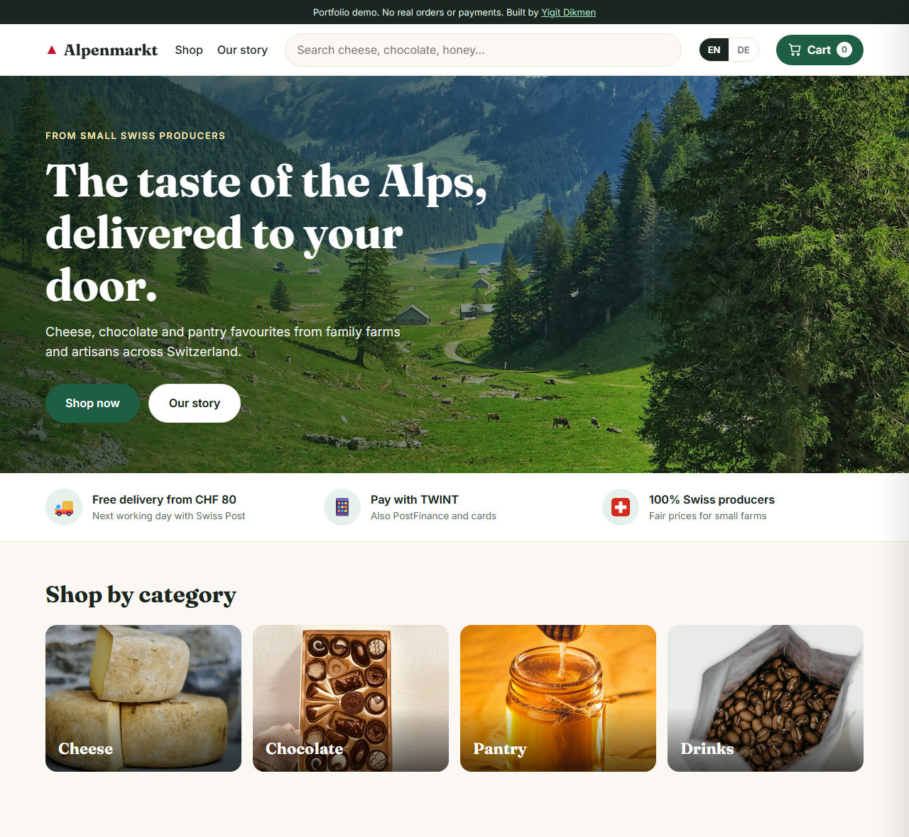
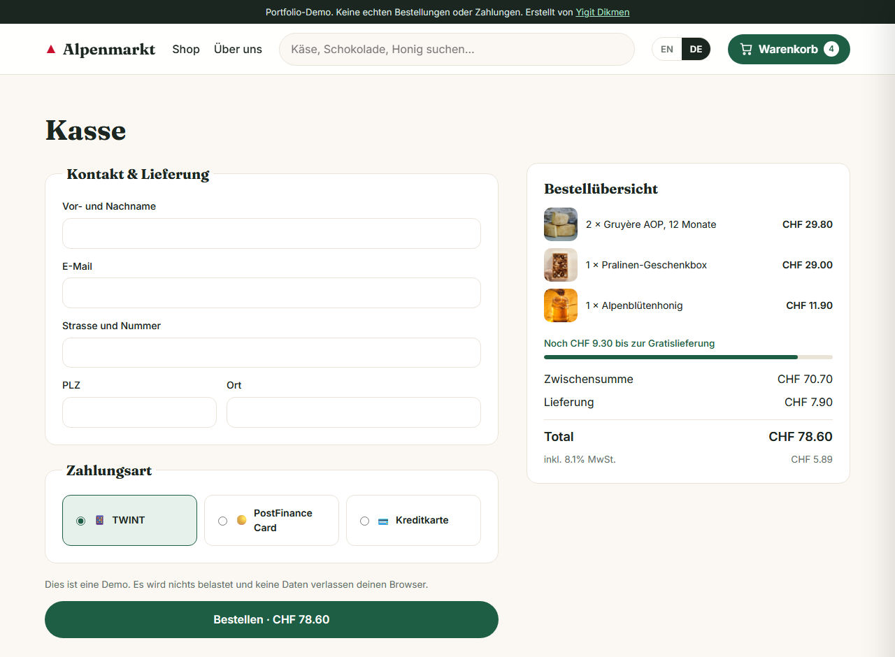
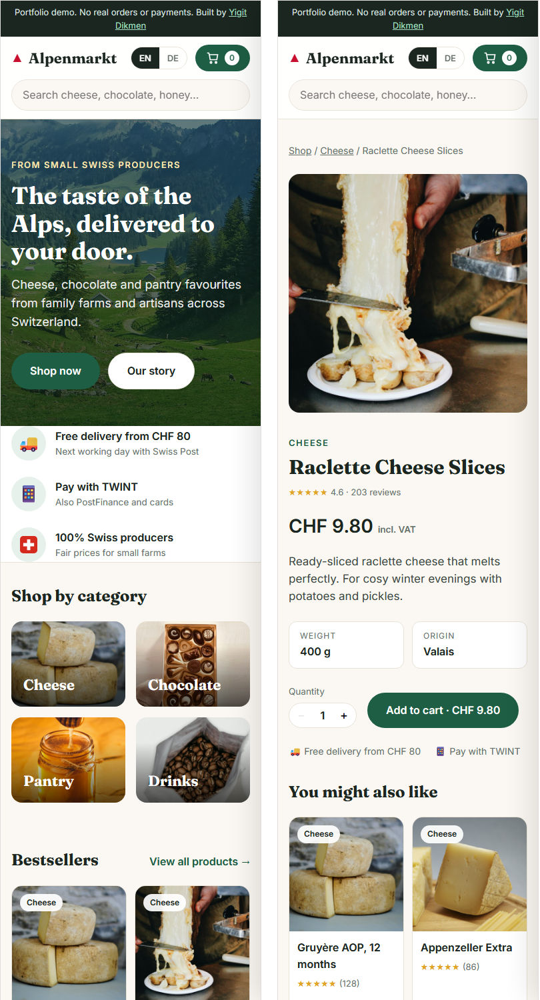

# 🏔️ Alpenmarkt: Swiss Regional Food Store

An e-commerce demo for Swiss regional food (cheese, chocolate, honey, coffee), built with **React, TypeScript and Vite**.

🔗 **Live demo:** https://yigitdikmenq.github.io/alpenmarkt-store/



> Portfolio project. No real orders or payments are processed and no data leaves the browser.

## Features

- **Product catalogue** with category pages, live search and sorting (price, rating)
- **Product detail pages** with quantity selector and related products
- **Cart drawer** with quantity controls, a free-delivery progress bar, and persistence in `localStorage`
- **Swiss checkout**: CHF prices, 8.1% VAT shown, free delivery from CHF 80, 4-digit postcode validation, and payment options TWINT / PostFinance / credit card (mocked)
- **English / German** interface (auto-detected from the browser, switchable in the header)
- **Shareable filters**: category, search and sort are stored in the URL (`#/shop?category=cheese&sort=price-asc`)
- **Responsive** from 360 px phones to wide desktops
- **Accessibility**: semantic HTML, labelled form fields with linked error messages, keyboard support (Esc closes the cart), visible focus states

| Checkout (German) | Mobile |
|---|---|
|  |  |

## Tech stack

| Area | Used |
|---|---|
| UI | React 19, TypeScript (strict) |
| Routing | React Router (`HashRouter` for GitHub Pages) |
| State | `useReducer` + Context for the cart, Context for the language |
| Styling | Plain CSS with custom properties (no UI library) |
| Testing | Vitest, React Testing Library, user-event |
| Build / CI | Vite, GitHub Actions (tests on every push, then deploy to GitHub Pages) |

## Engineering notes

- **Money is stored in Rappen (integers)**, e.g. `1490` = CHF 14.90. This avoids floating-point errors such as `0.1 + 0.2 = 0.30000000000000004`.
- **Business logic is kept in pure functions** (`cartReducer`, `calculateTotals`, `validateCheckout`, `filterProducts`) so it can be unit-tested without rendering any UI.
- **Translations are type-checked**: the German dictionary must contain every English key, or the build fails.

## Project structure

```
src/
  cart/        cartReducer, pricing (totals, VAT, delivery), CartContext
  checkout/    form validation
  components/  Header, CartDrawer, ProductCard, QuantityStepper, Footer
  data/        product catalogue and photo credits
  i18n/        EN/DE translations and LanguageContext
  pages/       Home, Shop, ProductPage, Checkout, OrderConfirmation
  shop/        filtering and sorting
```

## Run locally

```bash
npm install
npm run dev        # start the dev server
npm test           # run the test suite
npm run build      # type-check and build for production
```

## Tests

31 tests cover the pricing rules, cart reducer, form validation, filtering, and full user flows
(filter the shop → add to cart → validate checkout → place an order, language switch, cart persistence).

## Credits

Product photos come from [Unsplash](https://unsplash.com) (free licence). The photographers are credited in the site footer and in `src/data/photoCredits.json`.

## Author

**Yigit Dikmen**, Web Developer · [Portfolio](https://yigitdikmenq.github.io) · [GitHub](https://github.com/yigitdikmenq)
